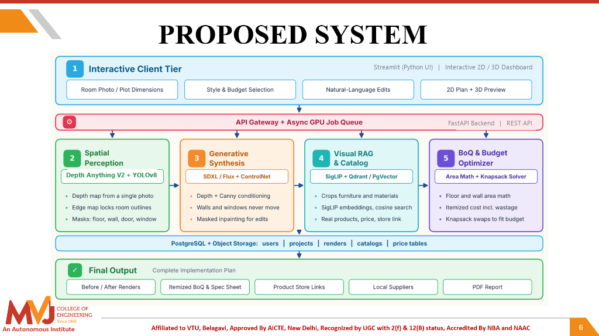
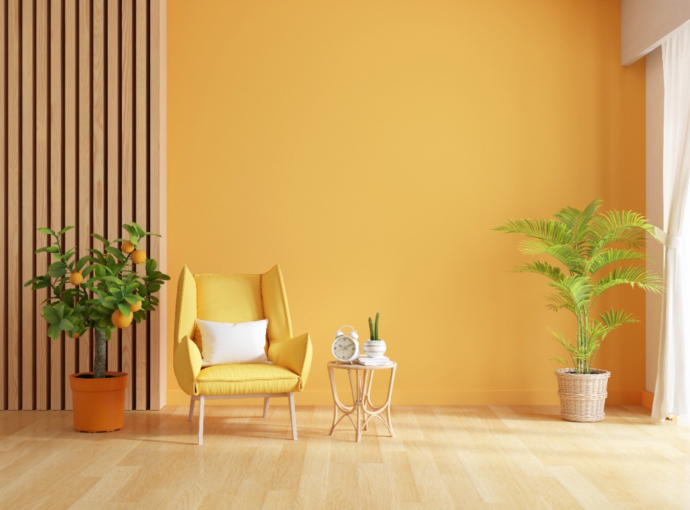
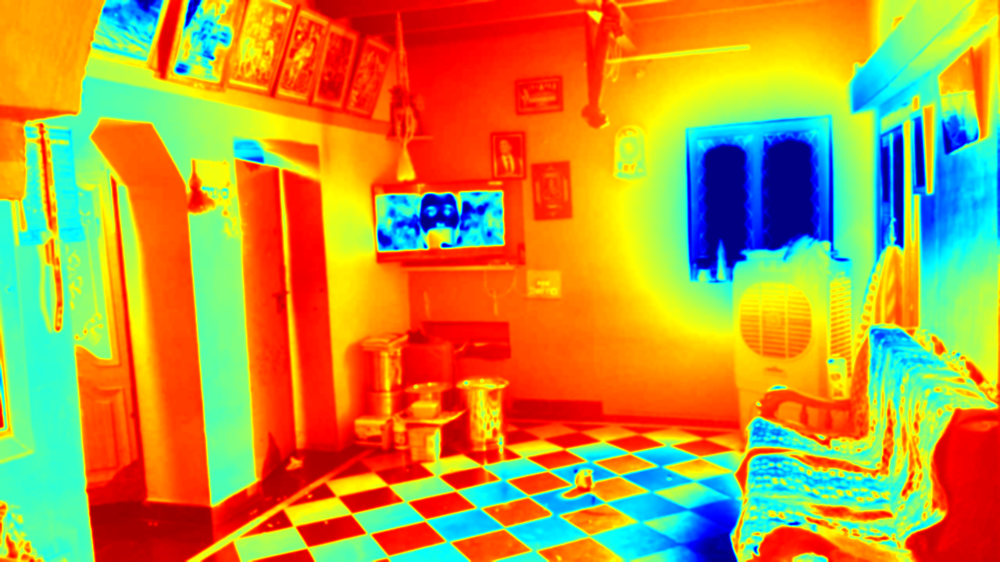
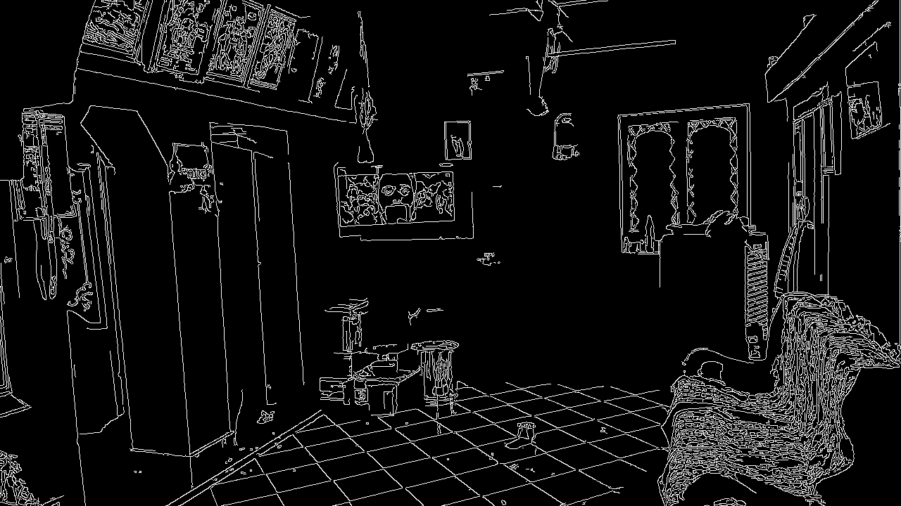
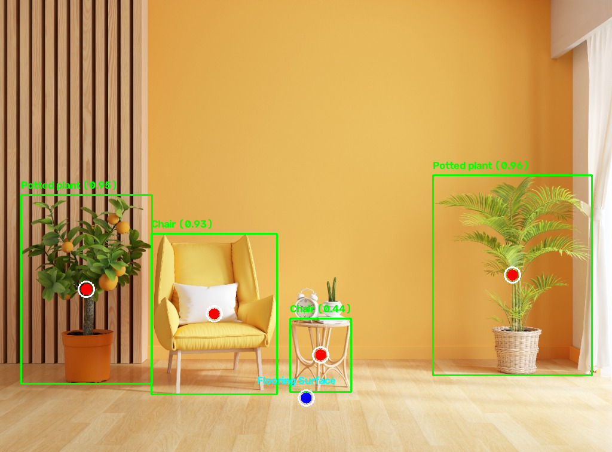
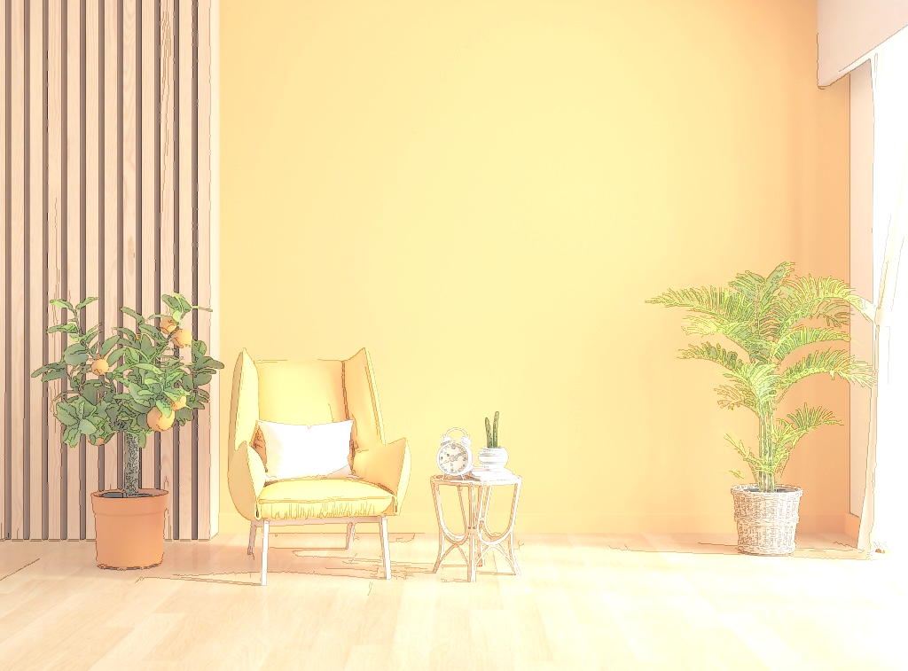
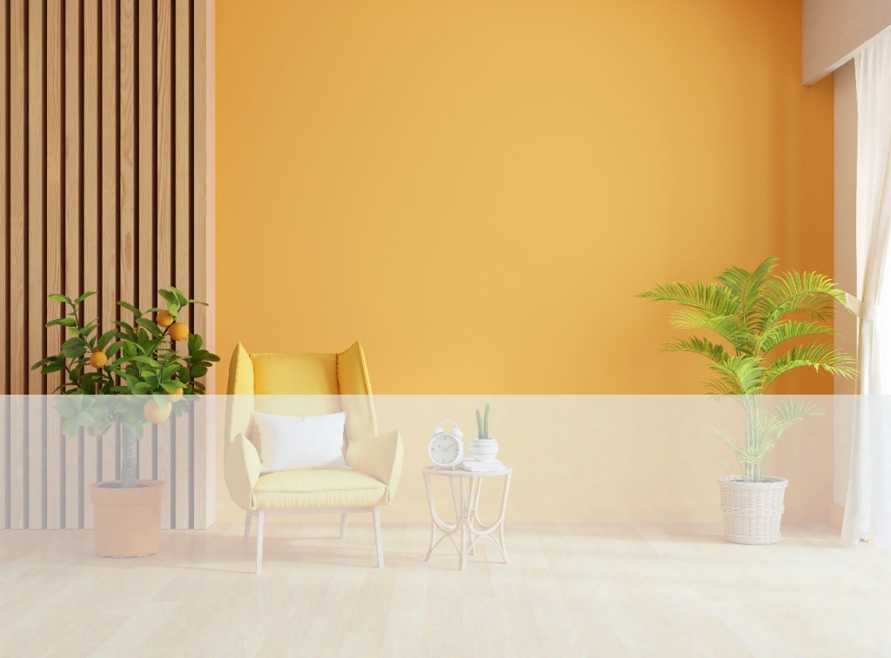

# AI-GLAZE 🏠✨
### AI-Powered Architectural Planning, Interior Synthesis, Material Recommendation & Budget Optimization Platform

[](https://www.python.org/)
[](https://streamlit.io/)
[](https://github.com/ultralytics/ultralytics)
[](https://opencv.org/)
[](https://opensource.org/licenses/MIT)

> **Department of Artificial Intelligence & Machine Learning**  
> **MVJ College of Engineering, Bangalore (Affiliated to Visvesvaraya Technological University - VTU)**  
> **Project Guide:** Prof. Ankita Mishra  

---

## 📌 Executive Summary

Traditional residential planning and interior renovation in India suffer from opaque contractor pricing, disjointed vendor ecosystems, and rigid 2D blueprints that homeowners struggle to visualize. **AI-GLAZE** resolves these inefficiencies by uniting spatial computer vision, generative redesign, deep-learning furniture detection, and localized cost engineering into a unified, role-based platform.

Whether designing an empty plot or redesigning an existing living space, **AI-GLAZE** locks structural geometry, generates photorealistic designs, localizes replacement materials, and calculates contractor-grade **Bills of Quantities (BoQ)** in **Indian Rupees (₹)** adhering to Tier-1 Indian market rates (Kajaria Vitrified Tiles, Asian Paints Royale, Urban Ladder).

---

## 🏗️ System Architecture

The end-to-end architecture integrates deep perception models, spatial geometry locking, and linear cost optimization:



---

## 🌟 Key Technical Innovations

### 1. Spatial Perception & Structural Locking
* **Depth Anything V2 Estimation:** Computes dense depth heatmaps from single RGB monocular camera inputs, classifying foreground furniture from architectural boundaries.
* **Canny Structural Edge Locking:** Retains permanent structural elements (load-bearing walls, window frames, door jambs) during stylistic transformations.
* **Dimensional Back-Projection:** Calculates room floor area ($\text{sq.ft}$) and perimeter surface areas based on standard Indian ceiling heights ($9.5\text{ ft}$).

### 2. Hybrid Generative Redesign Engine
* **Offline High-Fidelity Synthesis (Mode B):** Instant CPU/GPU localized architectural tone, ambient shadow curves, and material grain rendering (100% offline, zero latency, crash-proof for viva defense).
* **Cloud GPU Diffusion Hook (Mode A):** Plug-and-play architecture-conditioned ControlNet + SDXL endpoint hook for 4K ray-traced rendering.
* **Smart Magic Wand Inpainting:** Localized surface re-texturing (Italian Carrara Marble veining, Kajaria Vitrified tile grout grids, and teak grain) preserving surrounding decor.

### 3. YOLOv8 Deep-Learning Object Detection & Interactive Pins
* Employs **YOLOv8n** to accurately identify existing furniture (`couch`, `chair`, `dining table`, `tv`, `potted plant`).
* Computes normalized spatial coordinates $(x, y)$ and renders interactive pinpoint tags over real items for catalog replacement.

### 4. Mathematical Cost Engine & BoQ Generator (INR ₹)
* Formulates material selection as a **0/1 Knapsack Budget Optimization Problem**, ensuring utility is maximized within user budgets ($\text{₹}50,000 \text{ to } \text{₹}6,00,000$).
* Generates exportable, contractor-ready **Bill of Quantities (BoQ)** with 18% GST calculation, labor charges, and brand-level SKU mapping.

---

## 📸 Visual Pipeline Showcase

| Input Image | Depth Anything Heatmap | Structural Edge Wireframe |
| :---: | :---: | :---: |
|  |  |  |

| YOLOv8 Furniture Detection | Style Synthesis (Scandinavian) | Localized Tile/Marble Inpaint |
| :---: | :---: | :---: |
|  |  |  |

---

## 👥 Team & Responsibilities

| Name | USN | Role & Primary Ownership |
| :--- | :--- | :--- |
| **K M Sanjana** *(Lead)* | `1MJ24AI024` | **System Architect, Computer Vision & AI Lead**<br>• Depth estimation, YOLOv8 furniture detection & pins, hybrid generative engine |
| **Akshata A Kalmud** | `1MJ24AI005` | **Interactive UI & 2D Floorplan Lead**<br>• Streamlit multi-tab architecture, 2D plot-to-blueprint layout generator, design controls |
| **Anjana R** | `1MJ24AI008` | **Product Catalog & Visual Search Lead**<br>• Indian supplier SKU catalog (`catalog.csv`), CLIP embedding visual similarity search |
| **C Yuvashree** | `1MJ24AI014` | **Cost Engineering, BoQ & Reporting Lead**<br>• Knapsack budget optimization math, contractor BoQ PDF/HTML engine, GST calculation |

---

## 🚀 Quickstart & Installation

### Prerequisites
* Python 3.10 or higher
* Git

### 1. Clone the Repository
```bash
git clone https://github.com/sanjanahoskote21-cell/ai-glaze.git
cd ai-glaze
```

### 2. Install Dependencies
```bash
pip install -r requirements.txt
```

### 3. Run the AI-GLAZE Application
```bash
streamlit run ui_dashboard.py
```

### 4. Demo Credentials (Built-in SQLite Auth)
* **Architect Mode:** `architect_demo` / `demo123`
* **Homeowner Mode:** `homeowner_demo` / `demo123`

---

## 📊 Project Structure

```plaintext
ai-glaze/
├── ui_dashboard.py          # Primary Streamlit Interactive Dashboard
├── vision_engine.py         # Depth Anything, Canny, YOLOv8, Hybrid Synthesis
├── auth_manager.py          # SQLite authentication & saved user projects
├── cost_engine.py           # BoQ calculation & Knapsack budget optimization
├── app.py                   # Master CLI orchestrator & fallback pipeline
├── real_room.jpeg           # Sample living room image for demonstration
├── users.db                 # SQLite database for user accounts and portfolio
├── requirements.txt         # Project dependencies
├── proposed_system_updated.png # Architecture diagram for presentation
└── catalog_manager/         # Indian supplier catalog & CLIP vector search
    ├── catalog.csv          # Localized material & furniture catalog
    └── build_index.py       # Catalog indexing & similarity retrieval
```

---

## 📜 Academic Affiliation
Developed as a Major Capstone Project at **MVJ College of Engineering, Bangalore**, affiliated to **Visvesvaraya Technological University (VTU)**, Belagavi, Karnataka.
